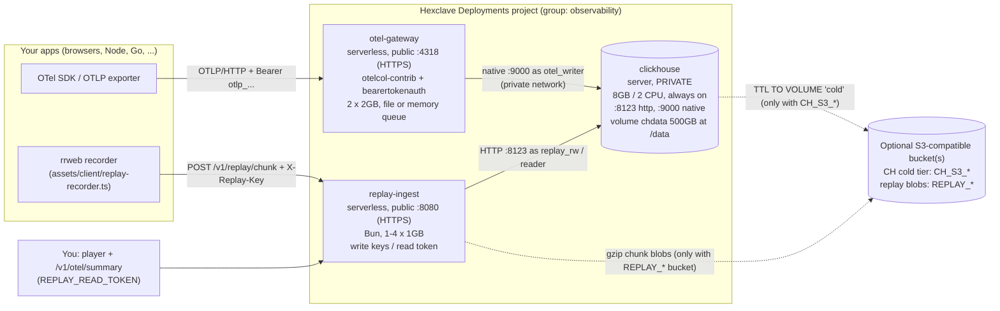

# Architecture

Three Hexclave Deployments services, all in one deployment group (`observability`), on the
default runtime (no `version` export).

## Services

| Service | Type | Exposure | Size | Notes |
|---|---|---|---|---|
| `clickhouse` | `server` | private only (TCP 9000 and HTTP 8123) | 8GB, 2 CPU, `minInstances: 1` | One volume (`chdata`, 1–500GB, default 500) at `/data`. Schema and users are applied on every boot by an idempotent initdb script. |
| `otel-gateway` | `serverless` | public HTTPS, container port 4318 | 2GB, min=max=`OTEL_GATEWAY_INSTANCES` (2) | OTLP/HTTP only. Public services are HTTP-only, so OTLP/gRPC on 4317 can't be exposed. |
| `replay-ingest` | `serverless` | public HTTPS, container port 8080 | 1GB, 1–4 instances | Ingests rrweb chunks, serves the session list, the player, and a `/v1/otel/summary` read endpoint. |

## Storage modes (chosen at deploy time by env vars)

| | Default (no bucket) | With a bucket |
|---|---|---|
| ClickHouse | policy `tiered` = one `hot` volume on the local disk; TTL `DELETE` after `OTEL_TTL_DAYS` | `hot` local + `cold` S3 disk behind a local cache; TTL moves parts to `cold` after `OTEL_HOT_DAYS`, deletes after `OTEL_TTL_DAYS`. Set `CH_S3_ENDPOINT` (trailing `/`), `CH_S3_REGION`, `CH_S3_ACCESS_KEY_ID`, `CH_S3_SECRET_ACCESS_KEY`, `CH_S3_BATCH_DELETE` (`false` for GCS). |
| Replay blobs | gzipped chunks in `replay.chunk_blobs` (String, ZSTD), same TTL as the index | the S3 bucket (`REPLAY_BUCKET`, `REPLAY_S3_*`); the index keeps the object key |

Both modes keep the policy name `tiered`, so tables never need to change policy. A ClickHouse
policy can't drop a volume, so going from S3 back to local-only means a new volume or data
migration. Treat S3 tiering as a one-way upgrade.

## Data flow details

- **Auth.** Gateway: `Authorization: Bearer <token>`, with tokens from `OTEL_INGEST_TOKENS`
  (comma-separated, written to a htpasswd-style file at start). Replay: `X-Replay-Key: <project>:<pk_...>`
  (write keys only allow writing to their project). Reads (sessions, player, summary) use
  `REPLAY_READ_TOKEN`, passed as a Bearer header or `#token=` in the player URL.
- **Private networking.** `service("clickhouse").hostname()` resolves to a private IPv6
  address (fdaa::/16). The ClickHouse users are network-restricted to that range, plus localhost for the
  initdb script.
- **Trace ↔ replay link.** Your app sends the replay session id to its backend (header
  `x-replay-session-id`), which puts it on spans as `session.id`. The backend returns
  `server-timing: traceparent;desc="00-<trace>--01"`, the recorder collects those trace
  ids with each chunk, and replay-ingest writes `trace_id → session` rows to `replay.trace_sessions`
  (`GET /v1/replay/by-trace/<traceId>`). Verified on the live deployment.
- **Exporter.** The gateway exports with the `clickhouse` exporter over the native protocol,
  `create_schema: false`. The schema is owned by `assets/sql/*.sql` and applied by initdb.
